<p align="center">
  
</p>

<p align="center">
  <a href="https://www.thiagoraphael.com.br"></a>
  <a href="https://www.linkedin.com/in/thiagoraphaeljustiniano/"></a>
  <a href="mailto:contato@thiagoraphael.com.br"></a>
  <a href="https://www.behance.net/thiago_raphael"></a>
</p>

<br>

Comecei no design gráfico e hoje programo as interfaces que antes eu só desenhava. Trabalho com **front-end** (React, Next.js, TypeScript) e **análise de dados** (Python, Pandas), e uso o olhar de design para levar o projeto do Figma ao deploy sem perder detalhe no caminho.

```txt
agora      analista de dados na UNIPAC
           professor no técnico em Redes do CTP Barbacena
estudando  pós em Engenharia de Software (PUC Minas)
local      Barbacena, MG · aberto a remoto e híbrido
```

## Projetos em destaque

<table>
  <tr>
    <td width="50%" valign="top">
      <h3><a href="https://www.naminhatela.com.br">Na Minha Tela</a></h3>
      Gerador de stories e posts com a capa do que você está lendo, jogando ou assistindo. Toda a renderização acontece no navegador: sem backend, sem cadastro, nenhuma imagem sai do aparelho.
      <br><br>
      <code>JavaScript puro</code> <code>Canvas 2D</code> <code>ES Modules</code> <code>Node (build)</code>
      <br><br>
      <a href="https://www.naminhatela.com.br">site</a> · <a href="https://github.com/thiagoraphael/na-minha-tela">código</a>
    </td>
    <td width="50%" valign="top">
      <h3><a href="https://www.circuitogeekmg.com.br">Circuito Geek</a></h3>
      Portal de notícias geek com CMS próprio. Login e permissões por papel com RLS no banco, editor Tiptap com embeds de X e Instagram, compressão de imagem no navegador antes do upload.
      <br><br>
      <code>Next.js 16</code> <code>React 19</code> <code>TypeScript</code> <code>Supabase</code> <code>Tailwind v4</code>
      <br><br>
      <a href="https://www.circuitogeekmg.com.br">site</a>
    </td>
  </tr>
  <tr>
    <td width="50%" valign="top">
      <h3><a href="LINK_DO_REPO_DO_TCC">IA para radiografias</a></h3>
      TCC: rede neural convolucional que identifica fraturas em radiografias de membros superiores.
      <br><br>
      <code>Python</code> <code>CNN</code> <code>Pandas</code> <code>NumPy</code>
      <br><br>
      <a href="LINK_DO_REPO_DO_TCC">código</a>
    </td>
    <td width="50%" valign="top">
      <h3><a href="https://github.com/thiagoraphael/tamagochi-v2">Tamagochi v2</a></h3>
      Extensão de Chrome (Manifest V3) com um bichinho virtual que reage aos seus hábitos de navegação.
      <br><br>
      <code>JavaScript</code> <code>Chrome Extension</code> <code>chrome.storage</code>
      <br><br>
      <a href="https://github.com/thiagoraphael/tamagochi-v2">código</a>
    </td>
  </tr>
</table>

## Stack

**Front-end**
<br>


**Back-end e dados**
<br>


**Design e ferramentas**
<br>


<br>

<p align="center">
  <sub>Se algo aqui te interessou, o caminho mais rápido é <a href="mailto:contato@thiagoraphael.com.br">contato@thiagoraphael.com.br</a>.</sub>
</p>
